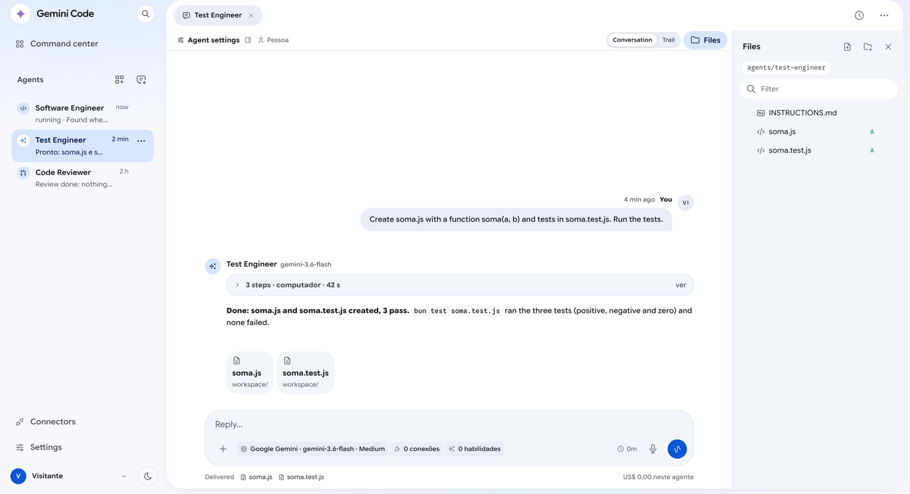
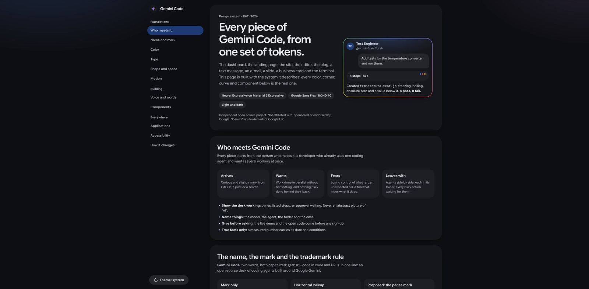

<div align="center">


# Gemini Code

**An open-source desk where several coding agents, built around Google Gemini,
work on your software at the same time and ask a person before anything risky.**

<a href="https://github.com/ciro-maciel/gemini-code/releases/latest"></a>
<a href="LICENSE"></a>

<a href="https://ciro-maciel.github.io/gemini-code/"></a>

<a href="#download">Download</a> ·
<a href="https://ciro-maciel.github.io/gemini-code/">Live demo</a> ·
<a href="docs/install.md">Install guide</a> ·
<a href="CHANGELOG.md">Changelog</a> · <a href="README.pt-BR.md">Português</a>

<br>

<a href="https://ciro-maciel.github.io/gemini-code/">
<picture>
  <source media="(prefers-color-scheme: dark)" srcset="docs/images/desk-dark.png">
  
</picture>
</a>

<sub><a href="https://ciro-maciel.github.io/gemini-code/">Try the live demo</a>:
the real dashboard with example data, nothing to install.</sub>

</div>

## Download

<table>
  <tr>
    <th width="33%">macOS</th>
    <th width="33%">Linux</th>
    <th width="33%">Windows</th>
  </tr>
  <tr>
    <td align="center">
      <a href="https://github.com/ciro-maciel/gemini-code/releases/latest/download/gemini-code-darwin-arm64.tar.gz"></a><br>
      <a href="https://github.com/ciro-maciel/gemini-code/releases/latest/download/gemini-code-darwin-x64.tar.gz"></a>
    </td>
    <td align="center">
      <a href="https://github.com/ciro-maciel/gemini-code/releases/latest/download/gemini-code-linux-x64.tar.gz"></a><br>
      <a href="https://github.com/ciro-maciel/gemini-code/releases/latest/download/gemini-code-linux-arm64.tar.gz"></a>
    </td>
    <td align="center">
      <a href="https://github.com/ciro-maciel/gemini-code/releases/latest/download/gemini-code-windows-x64.zip"></a>
    </td>
  </tr>
</table>

Or install in one line, with no administrator rights. It picks the right file,
checks its SHA-256 and puts `gemini-code` on your PATH:

```bash
# macOS and Linux
curl -fsSL https://raw.githubusercontent.com/ciro-maciel/gemini-code/main/install.sh | sh
```

```powershell
# Windows (PowerShell)
powershell -c "irm https://raw.githubusercontent.com/ciro-maciel/gemini-code/main/install.ps1 | iex"
```

Then run `gemini-code`, or `gemini-code ~/code/my-app` to point the agents at a
project. The macOS builds are signed and notarized by Apple. Every version and
its checksums: [Releases](https://github.com/ciro-maciel/gemini-code/releases).

Coding agents that read a repository, run commands and ship changes are already
part of how developers work. One agent at a time is the easy part. The hard part
comes next: running several at once without them overwriting each other, and
keeping a person in charge of what matters.

Gemini Code is an open answer to that, built around Gemini. You open as many
agents as the work needs (an engineer, a reviewer, a debugger) and watch them
work in parallel. Each agent works in its own folder: its terminal starts there,
its file tree sits next to its conversation, and it cannot read or write outside
it.

> Independent open-source project. Not affiliated with, sponsored or endorsed by
> Google. "Gemini" is a trademark of Google LLC.

---

## What it does

- **A desk of agents (Mesa).** Split panes, one agent per pane, all running at
  once. The command center shows who is working, who is waiting for you and what
  each one changed.
- **Built around Gemini.** Talks to the Gemini API directly: streaming, thinking
  summaries, function calling, images and cached tokens. Gemini is the default
  and the only provider set up out of the box; the engine also speaks the OpenAI
  chat format, so another provider works with its own key.
- **A person decides what matters.** A risk judge reads every shell command,
  browser action and connector write before it runs. Payments and sign-ins ask
  you every time. Sending, publishing and deleting ask until you choose to
  always allow them, so routine work stops asking.
- **Secrets stay out of the model.** A per-agent encrypted vault puts keys only
  into the command's environment and removes their values from everything the
  model reads.
- **Connectors through MCP.** GitHub, Linear, Sentry, Cloudflare, Notion, Figma
  and others through their official remote MCP servers, plus a browser the agent
  can drive.
- **One official way to reach Gemini.** Every agent runs on the Gemini API with
  your own key from Google AI Studio. Signing in with a Google AI Pro or Ultra
  subscription waits for Google to publish an official path for third-party
  tools; see [Google accounts](#google-accounts) below.
- **Each agent's folder, through one MCP.** A files MCP server with four tools
  (guide, read, write, delete) covers listing, tree, reading, searching,
  writing, editing, moving, copying and deleting, all locked inside the agent's
  folder. Deleting always waits for the person. The dashboard's tree uses the
  same routes, and any MCP client (Antigravity CLI, Gemini CLI, Claude Code) can
  mount it at `/api/bots/<agent>/mcp/files`. See
  [docs/files-mcp.md](docs/files-mcp.md).
- **On your machine.** One executable runs the server and the dashboard on your
  computer, against your folders, with no account and no login. Nothing runs in
  a cloud of ours.

## Quickstart (from source)

You need [Bun](https://bun.sh) 1.2+ and a Gemini API key from
[Google AI Studio](https://aistudio.google.com/apikey). The free tier is enough
to try it.

```bash
git clone https://github.com/ciro-maciel/gemini-code.git
cd gemini-code
bun install
cp .env.example .env        # set GEMINI_API_KEY=...
bun run dev                 # control server on :8787, dashboard on :5180
```

Open http://localhost:5180. To put the agents on your own code, open Settings ›
Projects, choose the folder that holds your repositories (for example `~/code`),
and pick a repository in each agent's settings. Each agent works in its own
`git worktree` of it, on the branch `gemini-code/<agent>`, so agents never
overwrite each other or what you are editing.

## Models

The default is the fastest Gemini model that answered reliably on the free tier
when we tried them. Change it with `DEFAULT_MODEL`.

| Model                             | Use                                    |
| --------------------------------- | -------------------------------------- |
| `gemini-3.5-flash-lite` (default) | Everyday steps, the risk judge, titles |
| `gemini-3.6-flash`                | Harder work across many files          |
| `gemini-3.5-flash`                | Fallback when the others are busy      |

In one run on 24/11/2026 (free tier, a prompt that calls one tool),
`gemini-3.5-flash-lite` started answering in 0.75 s and `gemini-3.6-flash` in
1.5 s. When a model is overloaded or out of quota, the engine moves to the next
healthy one on its own.

## Google accounts

**The official way today is a Gemini API key.** A key from
[Google AI Studio](https://aistudio.google.com/apikey) is the path Google
documents and supports for third-party tools, with a free tier and billing by
use on your own Google account. Vertex AI, the same API inside a Google Cloud
project, is the variant for companies and may come later.

**Signing in with a Google subscription is waiting for Google.** A Google AI Pro
or Ultra subscription has no official path for third-party tools yet:

- Gemini CLI's Google sign-in refuses personal subscriptions since November 2026
  ("This client is no longer supported for Gemini Code Assist for individuals"),
  and the Gemini CLI SDK is not published on npm.
- Google has hinted that an official way for third-party harnesses to use the
  subscription is coming. There is no confirmed date and no documentation yet.

Until then Gemini Code offers only the API key. The subscription transport
(Google's Antigravity CLI over the Agent Client Protocol, every tool call asking
Gemini Code first) stays in the code as an experiment for personal use,
described in [docs/subscription.md](docs/subscription.md). When Google publishes
the official path, it comes back as "Sign in with Google".

## How it is built

| Folder                | Stack                     | What it is                                                                                                  |
| --------------------- | ------------------------- | ----------------------------------------------------------------------------------------------------------- |
| `packages/server/`    | Bun, SQLite (WAL)         | REST API and live streams, the agent loop, the Gemini adapter, risk judge, MCP client, vault, local runtime |
| `packages/dashboard/` | React 19, Vite, Mantine 8 | The desk: panes, command center, agent conversations, approvals, audit trail                                |
| `workspace/`          | Files                     | Where agents and shared skills live by default                                                              |

Where to start reading: `packages/server/src/engine/run.js` (the loop),
`packages/server/src/engine/gemini.js` (the API),
`packages/server/src/engine/policy.js` (what needs a person),
`packages/server/src/engine/model-router.js` (failover).

## Design system

Gemini Code mirrors the Gemini app's design language (Neural Expressive on
Material 3 Expressive) on every screen and every piece made for it.

[](docs/2026-11-25-design-system.md)

- [docs/2026-11-25-design-system.md](docs/2026-11-25-design-system.md): the
  reference. Color, type, shape, motion, voice, the dashboard's components, and
  the rules for the landing page, site, editor, terminal, blog, text messages,
  e-mail, slides, social posts and business cards.
- [docs/2026-11-25-design-system.html](docs/2026-11-25-design-system.html): the
  same system as a page built from its own tokens, with live components and a
  specimen of each piece. Download it and open it in a browser.
- The values live in `packages/dashboard/src/neural-expressive.css`;
  [docs/design.md](docs/design.md) says why each choice was made.

## Roadmap

**Milestone 1, almost done: each agent with its own file tree.** Done: the
shared Files tab is gone; each agent's tree shows next to its conversation and
updates live, with what it added (A) or modified (M) marked; its terminal starts
in its own folder; the files MCP locks every file operation inside it; each
agent that picks a repository works in its own `git worktree` of it.

Later milestones are discussed in the issues.

## Contributing

Issues and pull requests are welcome. Read [CONTRIBUTING.md](CONTRIBUTING.md)
first; agents working on this repository read [GEMINI.md](GEMINI.md). What
changed and when is in [CHANGELOG.md](CHANGELOG.md).

```bash
bun run preflight   # format check, lint and every test, before a pull request
bun run test        # unit tests in packages/server and packages/dashboard
bun run format      # Prettier, in the Gemini CLI style
```

## Who makes it

Gemini Code was started by
[Ciro Cesar Maciel](https://ciromaciel.click/?ref=oss-gemini-code), who builds
software and AI agents and publishes the tools he uses as open source.

## License

[Apache License 2.0](LICENSE). Copyright 2026 Ciro Cesar Maciel and
contributors.

Leia em português: [README.pt-BR.md](README.pt-BR.md).
