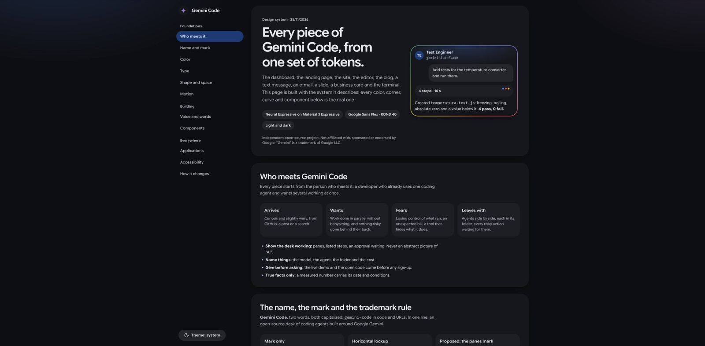

# Gemini Code

**Uma mesa aberta onde vários agentes de programação, construídos em volta do
Gemini do Google, trabalham no seu software ao mesmo tempo e pedem a uma pessoa
antes de qualquer coisa arriscada.**

## Baixar

| Sistema                   | Download                                                                                                                               | Ou no terminal                                                                                          |
| ------------------------- | -------------------------------------------------------------------------------------------------------------------------------------- | ------------------------------------------------------------------------------------------------------- |
| **macOS** (Apple silicon) | [gemini-code-darwin-arm64.tar.gz](https://github.com/ciro-maciel/gemini-code/releases/latest/download/gemini-code-darwin-arm64.tar.gz) | `curl -fsSL https://raw.githubusercontent.com/ciro-maciel/gemini-code/main/install.sh \| sh`            |
| **macOS** (Intel)         | [gemini-code-darwin-x64.tar.gz](https://github.com/ciro-maciel/gemini-code/releases/latest/download/gemini-code-darwin-x64.tar.gz)     | o mesmo comando                                                                                         |
| **Linux** (x64)           | [gemini-code-linux-x64.tar.gz](https://github.com/ciro-maciel/gemini-code/releases/latest/download/gemini-code-linux-x64.tar.gz)       | o mesmo comando                                                                                         |
| **Linux** (ARM64)         | [gemini-code-linux-arm64.tar.gz](https://github.com/ciro-maciel/gemini-code/releases/latest/download/gemini-code-linux-arm64.tar.gz)   | o mesmo comando                                                                                         |
| **Windows** (x64)         | [gemini-code-windows-x64.zip](https://github.com/ciro-maciel/gemini-code/releases/latest/download/gemini-code-windows-x64.zip)         | `powershell -c "irm https://raw.githubusercontent.com/ciro-maciel/gemini-code/main/install.ps1 \| iex"` |

O comando é o caminho fácil: escolhe o arquivo certo, confere o SHA-256 e põe
`gemini-code` no PATH, sem administrador. Depois rode `gemini-code`, ou
`gemini-code ~/code/meu-app` para os agentes trabalharem no seu projeto. As
versões de macOS são assinadas e notarizadas pela Apple. Todas as versões e
somas: [Releases](https://github.com/ciro-maciel/gemini-code/releases).
Detalhes: [docs/install.md](docs/install.md).

Agentes de programação que leem um repositório, rodam comandos e entregam
mudanças já fazem parte de como desenvolvedores trabalham. Um agente por vez é a
parte fácil. A difícil vem depois: rodar vários juntos sem que um apague o
trabalho do outro, com uma pessoa no comando do que importa.

O Gemini Code é uma resposta aberta a isso, construída em volta do Gemini. Você
abre quantos agentes o trabalho pede (um engenheiro, um revisor, um depurador) e
acompanha todos trabalhando ao mesmo tempo. Cada agente trabalha na própria
pasta: o terminal dele começa ali, a árvore de arquivos fica ao lado da
conversa, e ele não lê nem escreve fora dela.

**[Veja a demonstração ao vivo](https://ciro-maciel.github.io/gemini-code/)**: o
painel de verdade com dados de exemplo, sem instalar nada.

> Projeto aberto e independente. Sem vínculo, patrocínio ou endosso do Google.
> "Gemini" é marca do Google LLC.

---

## O que ele faz

- **Uma mesa de agentes (Mesa).** Painéis divididos, um agente por painel, todos
  rodando juntos. O centro de comando mostra quem está trabalhando, quem espera
  por você e o que cada um mudou.
- **Construído em volta do Gemini.** Fala direto com a API do Gemini: streaming,
  resumo do raciocínio, chamada de função, imagem e tokens em cache. O Gemini é
  o padrão e o único provedor configurado de fábrica; o motor também fala o
  formato de chat da OpenAI, então outro provedor funciona com a chave dele.
- **Uma pessoa decide o que importa.** Um avaliador de risco lê cada comando,
  ação no navegador e escrita por conector antes de rodar. Pagamento e login
  perguntam toda vez. Envio, publicação e exclusão perguntam até você escolher
  permitir sempre, e o trabalho de rotina para de perguntar.
- **Segredo não chega ao modelo.** Um cofre cifrado por agente põe a chave só no
  ambiente do comando e tira o valor de tudo o que o modelo lê.
- **Conectores por MCP.** GitHub, Linear, Sentry, Cloudflare, Notion, Figma e
  outros pelos servidores MCP oficiais, mais um navegador que o agente usa.
- **Entre com a sua assinatura Google.** Os agentes podem rodar numa assinatura
  Google AI Pro ou Ultra pelo Antigravity CLI do Google, que abre a família
  Gemini 4 (Neon e outros) sem cobrança de API. Veja
  [docs/subscription.md](docs/subscription.md).
- **A pasta de cada agente, por um MCP.** Um servidor MCP de arquivos com quatro
  ferramentas (guia, ler, escrever, apagar) cobre listar, árvore, ler, buscar,
  escrever, editar, mover, copiar e apagar, tudo preso dentro da pasta do
  agente. Apagar sempre espera a pessoa. A árvore do painel usa as mesmas rotas,
  e qualquer cliente MCP (Antigravity CLI, Gemini CLI, Claude Code) pode se
  ligar em `/api/bots/<agente>/mcp/files`. Veja
  [docs/files-mcp.md](docs/files-mcp.md).
- **Local primeiro.** Roda na sua máquina, sobre uma pasta, sem conta e sem
  login. Nada roda numa nuvem nossa.

## Começar (pelo código)

Você precisa do [Bun](https://bun.sh) 1.2+ e de uma chave da API Gemini no
[Google AI Studio](https://aistudio.google.com/apikey). O nível gratuito basta
para experimentar.

```bash
git clone https://github.com/ciro-maciel/gemini-code.git
cd gemini-code
bun install
cp .env.example .env        # preencha GEMINI_API_KEY=...
bun run dev                 # servidor em :8787, painel em :5180
```

Abra http://localhost:5180. Para os agentes trabalharem no seu projeto:

```bash
WORKSPACE_DIR=/caminho/do/seu/repo bun run dev
```

## Modelos

O padrão é o modelo Gemini mais rápido que respondeu de forma estável no nível
gratuito quando testamos. Troque com `DEFAULT_MODEL`.

| Modelo                           | Uso                                              |
| -------------------------------- | ------------------------------------------------ |
| `gemini-3.5-flash-lite` (padrão) | Passos do dia a dia, avaliador de risco, títulos |
| `gemini-3.6-flash`               | Trabalho difícil, em muitos arquivos             |
| `gemini-3.5-flash`               | Reserva quando os outros estão ocupados          |

Numa rodada em 24/11/2026 (nível gratuito, um pedido que chama uma ferramenta),
o `gemini-3.5-flash-lite` começou a responder em 0,75 s e o `gemini-3.6-flash`
em 1,5 s. Quando um modelo está sobrecarregado ou sem cota, o motor passa
sozinho para o próximo que está bem.

## Como é construído

| Pasta                 | Tecnologia                | O que é                                                                                                                    |
| --------------------- | ------------------------- | -------------------------------------------------------------------------------------------------------------------------- |
| `packages/server/`    | Bun, SQLite (WAL)         | API e transmissão ao vivo, o laço do agente, o adaptador do Gemini, avaliador de risco, cliente MCP, cofre, execução local |
| `packages/dashboard/` | React 19, Vite, Mantine 8 | A mesa: painéis, centro de comando, conversas dos agentes, aprovações, trilha de auditoria                                 |
| `workspace/`          | Arquivos                  | Onde moram os agentes e as habilidades compartilhadas                                                                      |

## Design system

O Gemini Code espelha a linguagem visual do app Gemini (Neural Expressive sobre
Material 3 Expressive) em cada tela e em cada peça feita para ele.

[](docs/2026-11-25-design-system.md)

- [docs/2026-11-25-design-system.md](docs/2026-11-25-design-system.md): a
  referência. Cor, tipografia, forma, movimento, voz, os componentes do painel e
  as regras para landing page, site, editor, terminal, blog, mensagens, e-mail,
  slides, posts e cartão de visita (em inglês).
- [docs/2026-11-25-design-system.html](docs/2026-11-25-design-system.html): o
  mesmo sistema como página, feita com os próprios tokens, com componentes
  funcionando e um exemplo de cada peça. Baixe e abra no navegador.
- Os valores ficam em `packages/dashboard/src/neural-expressive.css`;
  [docs/design.md](docs/design.md) explica o porquê de cada escolha.

## Próximos passos

**Marco 1, quase pronto: cada agente com a sua árvore de arquivos.** Feito: a
aba Arquivos compartilhada saiu; a árvore de cada agente fica ao lado da
conversa e se atualiza ao vivo, com o que ele criou (A) ou alterou (M) marcado;
o terminal dele começa na própria pasta; o MCP de arquivos prende toda operação
dentro dela. Falta: dar a cada agente o seu `git worktree` do projeto.

Os marcos seguintes são discutidos nas issues.

## Contribuir

Issues e pull requests são bem-vindos. Leia o [CONTRIBUTING.md](CONTRIBUTING.md)
antes; agentes que trabalham neste repositório leem o [GEMINI.md](GEMINI.md).

## Quem faz

O Gemini Code foi criado por
[Ciro Cesar Maciel](https://ciromaciel.click/?ref=oss-gemini-code), que constrói
software e agentes de IA e publica como código aberto as ferramentas que usa.

## Licença

[Apache License 2.0](LICENSE). Copyright 2026 Ciro Cesar Maciel e colaboradores.

Read in English: [README.md](README.md).
